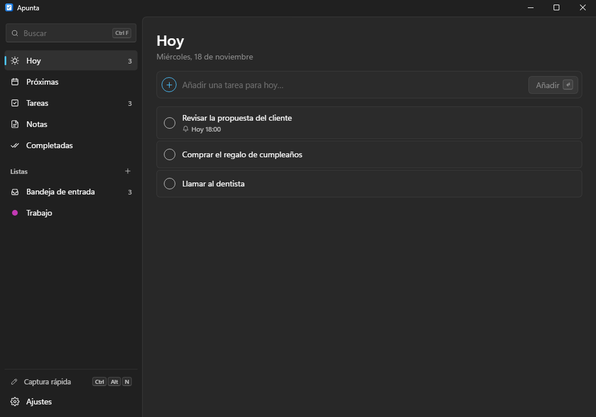
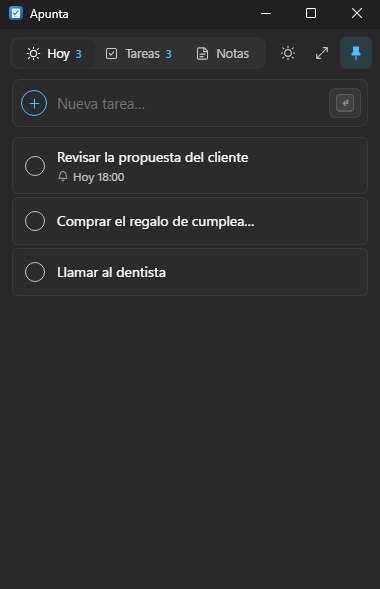

<div align="center">


# NowNotes

**Notas y tareas rápidas para Windows, con recordatorios.**
Ligera (unos 2 MB), moderna y sin cuentas: todo se guarda en tu equipo.

[](https://github.com/hujeanpaes/nownotes/actions/workflows/ci.yml)
[](https://github.com/hujeanpaes/nownotes/releases/latest)
[](LICENSE)

&nbsp;&nbsp;

</div>

## Funciones

- **Tareas y notas con identidad propia.** Las tareas se completan, tienen fecha y aparecen en *Hoy* y *Próximas*. Las notas son tarjetas de texto con formato (negrita, listas, enlaces y casillas que se marcan con un clic).
- **Fechas en lenguaje natural.** Escribe «llamar a Ana mañana a las 9» o «pay rent next friday» y la fecha y el aviso se ponen solos, en español e inglés.
- **Captura rápida desde cualquier sitio** con `Ctrl+Alt+N`, y `Ctrl+Alt+A` para mostrar u ocultar la ventana.
- **Recordatorios** con notificación de Windows, ventana de aviso y sonido. Pueden repetirse (cada día, días laborables, semana, mes o año) y posponerse 5 min, 1 h o hasta mañana.
- **Organización** con listas de colores, etiquetas, búsqueda, elementos fijados y orden manual arrastrando.
- **Papelera** que guarda lo eliminado 10 días por si necesitas recuperarlo.
- **Copias de seguridad automáticas** diarias (se guardan las últimas 7) y restaurables desde Ajustes.
- **Modo mínimo**: una ventana compacta tipo widget con Hoy, Tareas y Notas, buscador y selector de tarea o nota.
- **Anclar la ventana** encima de todas las demás, en cualquiera de los dos modos.
- **Diseño Windows 11** con efecto Mica. Tema oscuro por defecto y claro con un clic en el sol o la luna.
- **Atajos configurables**, con aviso si chocan con Windows u otra aplicación.
- **Bandeja del sistema e inicio con Windows**, para que los avisos lleguen aunque cierres la ventana. El icono muestra las tareas pendientes de hoy.
- **Instalable o portable.** La versión portable guarda los datos junto al ejecutable.

## Descarga

Descarga la última versión desde **[Releases](https://github.com/hujeanpaes/nownotes/releases/latest)**:

| Archivo | Para quién |
| --- | --- |
| `NowNotes_x.y.z_x64-setup.exe` | Instalación normal para tu usuario, sin permisos de administrador. Datos en `%APPDATA%\NowNotes`. |
| `NowNotes_x.y.z_x64_portable.zip` | Sin instalación: descomprime y ejecuta `NowNotes.exe`. Mientras exista el archivo `portable` junto al ejecutable, los datos se guardan en la carpeta `data/` de al lado. |

Requisitos: Windows 11 de 64 bits. No está probada en Windows 10.

> **¿Venías de «Apunta»?** NowNotes es la misma app con nombre nuevo. Al abrirla por primera vez traslada tus datos sola, también el inicio con Windows. Después puedes desinstalar «Apunta» sin perder nada.

## Atajos de teclado

Todos se pueden cambiar en **Ajustes → Atajos de teclado**.

| Atajo | Acción |
| --- | --- |
| `Ctrl+Alt+N` | Captura rápida (desde cualquier programa) |
| `Ctrl+Alt+A` | Mostrar u ocultar NowNotes (desde cualquier programa) |
| `Ctrl+N` | Escribir una tarea o nota nueva |
| `Ctrl+F` | Buscar (también en modo mínimo) |
| `Ctrl+M` | Alternar modo mínimo y modo completo |
| `Ctrl+P` | Anclar o desanclar la ventana encima de las demás |
| `Ctrl+Mayús+L` | Cambiar entre tema oscuro y claro |
| `Tab` | Alternar entre tarea y nota al escribir en Hoy, listas o etiquetas |
| `Espacio` | Completar la tarea seleccionada |
| `Enter` | Editar el título del elemento seleccionado |
| `Supr` | Mover a la papelera (con opción de deshacer) |
| `↑` / `↓` | Moverse entre elementos |
| `Esc` | Cerrar el editor o la búsqueda |

En la captura rápida: `Enter` guarda, `Mayús+Enter` añade una línea, `Tab` cambia entre tarea y nota y `Esc` cierra.

## Privacidad

Todos los datos se guardan solo en tu equipo. La única conexión a internet es la comprobación diaria de versiones nuevas, que consulta la API pública de GitHub y se puede desactivar en Ajustes.

## Compilar desde el código

Necesitas [Rust](https://rustup.rs/) (toolchain MSVC), [Node.js LTS](https://nodejs.org/) y Visual Studio Build Tools con la carga de trabajo *Desarrollo para el escritorio con C++*.

```bash
npm install
npm run tauri dev     # modo desarrollo (datos en %APPDATA%\NowNotes-dev)
npm run check         # comprobación de tipos de la interfaz
npm run test:ui       # tests de la interfaz (fechas en lenguaje natural)
npm test              # tests de Rust
npm run release       # instalador + zip portable en release/
```

## Estructura

```
src/                   Interfaz (Svelte 5 + TypeScript)
  main/                Ventana principal
  quick/               Ventana de captura rápida
  reminder/            Ventana de aviso
  lib/
    api.ts             Llamadas al backend (comandos de Tauri)
    items.ts           Utilidades de tareas y notas
    dates.ts, nlp.ts   Fechas y fechas en lenguaje natural
    keys.svelte.ts     Atajos configurables
    markdown.ts        Markdown mínimo y seguro
    components/        Componentes de la interfaz
src-tauri/src/         Backend (Rust + Tauri 2)
  main.rs              Arranque, bandeja y atajos globales
  commands.rs          Comandos que usa la interfaz
  db.rs                SQLite: esquema, migraciones, CRUD y avisos
  backup.rs            Copias de seguridad diarias y restauración
  scheduler.rs         Recordatorios cada 15 s y mantenimiento horario
  recurrence.rs        Cálculo de repeticiones
  windows.rs           Ventanas (Mica, modos y anclado)
  paths.rs             Modo portable o instalado y migración desde «Apunta»
  logger.rs            Registro de errores en nownotes.log
scripts/               Empaquetado del zip portable
```

Si algo falla, los errores quedan en `nownotes.log`, dentro de la carpeta de datos (se ve en Ajustes → Datos).

## Licencia

[MIT](LICENSE) © 2026 hujeanpaes
